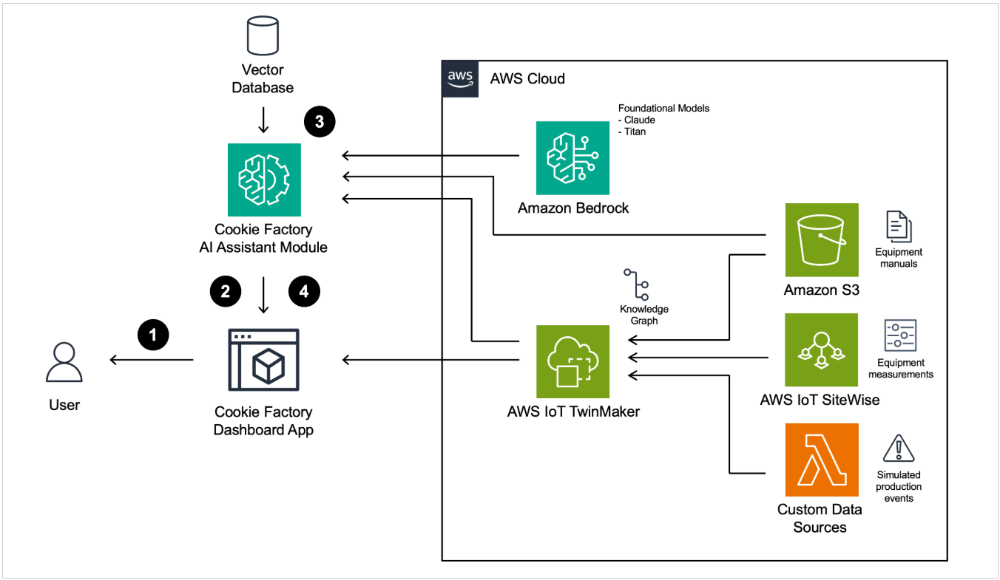

# 26년 10월 [Amazon AWS Certified Generative AI Developer - Professional(AIP-C01) 기출문제를 통해 AWS의 개념을 파악과 동시에 자격증 취득 목표]

1. 문제 및 정답 확인
2. 문제 설명
3. 정답 해설
4. 출제 의도 분석
5. 관련 AWS 공식 링크 공유

---

## 학습 개념 및 요약
---
* Q61 멀티모달 보안 및 컴플라이언스 로깅, "Bedrock Guardrails & Converse API: Guardrails의 민감 정보(PII) 및 주제(Topic) 정책으로 투자 조언과 정보 유출을 차단하고, Converse API와 S3 로깅을 연동해 이미지 포함 멀티모달 데이터의 완벽한 감사(Audit) 추적을 구현하는 법을 학습함."
* Q62 투명성 보장 및 대규모 RAG 아키텍처, "Agent Tracing & Serverless Stack: AI의 답변 추론 과정을 문서화하고 감사 로그를 남기기 위해 Bedrock 에이전트 추적(Tracing)을 활성화하고, 1만 명 동시 접속 처리를 위해 CloudFront, API Gateway, Lambda 기반의 서버리스 아키텍처를 결합하는 법을 학습함."
* Q63 RAG 검색을 위한 S3 메타데이터 설계, "S3 Metadata & Object Tags: 검색 정확도 향상을 위해 타임스탬프는 시스템 메타데이터에, 저자 정보는 사용자 정의 메타데이터에, 도메인 분류는 객체 태그에 할당하여 AI가 전체 문서를 읽지 않고도 컨텍스트를 이해하게 하는 아키텍처를 학습함."
* Q64 B2B SaaS 환경의 고객 데이터 주권 및 RAG 연동, "Amazon Q Business & API Access: B2B 고객의 데이터 주권을 보장하기 위해 고객 계정에 Q Business 인덱스를 구성하고, 서비스 제공자는 API를 통해 컨텍스트만 안전하게 검색(Retrieve)하여 프롬프트를 증강하는 최소 복잡성 아키텍처를 학습함."
* Q65 법률/전문 도메인 RAG 검색 고도화, "Hybrid Search & Reranker: 의미론적 문맥(벡터)과 정확한 법률 용어/인용구(키워드)를 모두 놓치지 않기 위해 OpenSearch 하이브리드 검색을 구성하고, Bedrock 리랭커로 최종 정밀도를 극대화하는 패턴을 학습함."
* Q66 대규모 GenAI 관측성 및 토큰 모니터링, "CloudWatch Logs Insights & Dashboards: 예측 불가능한 토큰 소비를 통제하기 위해 CloudWatch 지표(Metrics)로 실시간 대시보드와 경보를 설정하고, Logs Insights로 애플리케이션별 세부 토큰 소비 패턴을 쿼리 분석하는 최소 오버헤드 관측성 아키텍처를 학습함."
* Q67 고성능 보장 및 하이브리드 AI 배포, "Provisioned Throughput & SageMaker Neo: 대규모 배치 처리의 일관된 성능을 위해 Bedrock의 프로비저닝된 처리량을 구성하고, 데이터 레지던시 규정 준수를 위해 SageMaker Neo로 엣지/온프레미스 환경에 모델을 배포하는 하이브리드 아키텍처를 학습함."
* Q68 엔터프라이즈 GenAI 거버넌스 및 표준화, "CloudFormation & GenAI Lens: 다중 사업부의 RAG 아키텍처를 표준화하기 위해 Well-Architected GenAI Lens 기반의 CloudFormation 템플릿을 만들고, CloudFormation Guard와 CI/CD 파이프라인으로 일관된 보안/배포 정책을 강제하는 중앙 통제 거버넌스를 학습함."
* Q69 다국어 모델 업데이트 품질 검증 및 MLOps 자동화, "Bedrock Model Evaluation & CI/CD: 모델 업데이트 후 언어별 비일관성(환각)을 막기 위해 15k건의 다국어 병렬 테스트를 Bedrock 자동 모델 평가 작업으로 수행하고, 임계값 미달 시 CI/CD 파이프라인에서 배포를 자동 차단하는 품질 게이트를 학습함."
* Q70 도구별 토큰 소비 모니터링 및 동적 알람, "CloudWatch Metric Filters & Anomaly Detection: Bedrock 모델 호출 로그에서 지표 필터를 사용해 특정 도구(Tool)의 토큰 사용 패턴을 추출하고, 이상 탐지(Anomaly Detection)를 적용하여 트래픽 변화에 따라 알람 임계값을 자동으로 조정하는 고급 모니터링 아키텍처를 학습함."
---

## (문제1)
Q61
A bank is developing a generative AI (GenAI)-powered AI assistant that uses Amazon Bedrock to
assist the bank's website users with account inquiries and financial guidance. The bank must
ensure that the AI assistant does not reveal any personally identifiable information (PII) in
customer interactions.
The AI assistant must not send PII in prompts to the GenAI model. The AI assistant must not
respond to customer requests to provide investment advice. The bank must collect audit logs of
all customer interactions, including any images or documents that are transmitted during
customer interactions.
Which solution will meet these requirements with the LEAST operational effort?

[Answer]
C. Configure Amazon Bedrock guardrails to apply a sensitive information policy to detect and
filter PII. Set up a topic policy to ensure that the AI assistant avoids investment advice topics. Use
the Converse API to log model invocations. Enable delivery and image logging to Amazon S3.

### **1. 문제 및 정답 확인**

* **문제:** 은행의 Amazon Bedrock 기반 AI 비서가 (1) 고객 상호 작용에서 개인식별정보(PII)를 노출하지 않고, (2) 프롬프트에 PII를 포함하여 모델로 전송하지 않으며, (3) 투자 조언을 제공하지 않고, (4) 이미지나 문서를 포함한 모든 고객 상호 작용의 감사 로그(Audit logs)를 수집해야 함. 최소한의 운영 노력(LEAST operational effort)으로 이를 달성하는 방법은?
* **정답:** **C. PII를 탐지하고 필터링하는 민감한 정보 정책(Sensitive information policy)을 적용하도록 Amazon Bedrock 가드레일(Guardrails)을 구성함. AI 비서가 투자 조언 주제를 피하도록 주제 정책(Topic policy)을 설정함. 모델 호출을 로깅하기 위해 Converse API를 사용함. Amazon S3로의 전송 및 이미지 로깅을 활성화함.**

---

### **2. 문제 설명**

* **상황:** 은행 AI 비서에게 고객이 주민등록번호나 계좌번호(PII)를 입력하면, AI가 이를 아예 읽지도 못하게 사전에 차단해야 합니다. 또한 "어떤 주식을 살까요?" 같은 투자 상담은 법적 문제가 되므로 절대 대답하면 안 됩니다. 마지막으로, 고객이 신분증 사진 같은 이미지를 올렸을 때 이 이미지 로그까지 전부 S3 창고에 안전하게 보관(감사 기록)해야 합니다.
* **미션:** 복잡한 필터링 코드를 개발하지 않고, AWS Bedrock에 내장된 방어막(Guardrails)과 최신 통합 채팅 API(Converse API)를 활용하여 텍스트와 이미지를 아우르는 완벽한 보안 통제망을 구축해야 합니다.
* **핵심:** Bedrock Guardrails(PII 차단 및 주제 제한) + Converse API(멀티모달 통합) + 모델 호출 로깅(S3 이미지 로깅 활성화)의 조합입니다.

---

### **3. 정답 해설**

* **Bedrock Guardrails (민감 정보 및 주제 정책):**
* **Sensitive Information Policy (민감 정보 정책):** 사용자의 입력(프롬프트)에 PII가 포함되어 있으면, AI 모델에 도달하기 전에 Guardrail이 이를 탐지하여 마스킹하거나 차단합니다(PII 유출 및 모델 전송 원천 차단).
* **Topic Policy (주제 정책):** "투자 조언(Investment advice)"이라는 특정 카테고리를 거부(Denied) 주제로 설정하여 관련 질문에 대해 미리 정의된 안전한 거절 메시지를 출력하게 만듭니다.

* **Converse API & S3 로깅:** 기존의 `InvokeModel` API와 달리 **Converse API**는 멀티턴 대화와 텍스트/이미지/문서 등 멀티모달(Multi-modal) 입력을 표준화하여 처리합니다. Bedrock의 '모델 호출 로깅(Model Invocation Logging)' 기능을 켜고 S3를 목적지로 지정하면, 텍스트뿐만 아니라 Converse API를 통해 전달된 **이미지와 문서 파일까지 모두 감사 로그로 자동 저장**할 수 있습니다.

---

### **4. 문제 출제의도 분석**

* **Bedrock Guardrails 종합 활용:** 단일 Guardrail 안에서 PII 차단(Sensitive info)과 대화 주제 제한(Topic)을 동시에 구성하여 운영 공수를 최소화하는 방법을 아는지 평가합니다.
* **멀티모달 컴플라이언스(Audit Logging):** 텍스트뿐만 아니라 **이미지/문서**가 포함된 생성형 AI 상호작용에서, 이를 지원하는 **Converse API**와 Bedrock S3 로깅 기능을 엮어 완전한 감사(Audit) 추적 체계를 구성할 수 있는지 검증합니다.

---

### **5. 관련 AWS 공식 링크**

* [Amazon Bedrock Guardrails 설정 가이드 (주제 및 민감 정보 정책)](https://docs.aws.amazon.com/ko_kr/bedrock/latest/userguide/guardrails.html)
* [Amazon Bedrock 모델 호출 로깅 (이미지 및 멀티모달 데이터 S3 로깅)](https://docs.aws.amazon.com/ko_kr/bedrock/latest/userguide/model-invocation-logging.html)

---

## (문제2)
Q62
A financial services company is developing a customer service AI assistant application that uses
a foundation model (FM) in Amazon Bedrock. The application must provide transparent
responses by documenting reasoning and by citing sources that are used for Retrieval
Augmented Generation (RAG). The application must capture comprehensive audit trails for all
responses to users. The application must be able to serve up to 10,000 concurrent users and
must respond to each customer inquiry within 2 seconds.
Which solution will meet these requirements with the LEAST operational overhead?

[Answer]
A. Enable tracing for Amazon Bedrock agents. Configure structured prompts that direct the FM to
provide evidence presentations. Integrate Amazon Bedrock knowledge bases with data sources
to enable RAG. Configure the application to reference and cite authoritative content. Deploy the
application in a Multi-AZ architecture. Use Amazon API Gateway and AWS Lambda functions to
scale the application. Use Amazon CloudFront to provide low-latency delivery.

### **1. 문제 및 정답 확인**

* **문제:** 금융 서비스 회사가 Amazon Bedrock의 파운데이션 모델(FM)을 사용하는 고객 서비스 AI 비서를 개발 중임. 이 애플리케이션은 (1) 추론 과정을 문서화하고 RAG에 사용된 출처를 인용하여 투명한 응답(Transparent responses)을 제공하고, (2) 모든 응답에 대한 포괄적인 감사 추적(Audit trails)을 캡처해야 함. 또한 (3) 최대 10,000명의 동시 사용자를 처리하고 2초 이내(Low latency)에 응답해야 함. 최소한의 운영 오버헤드로 이를 충족하는 솔루션은?
* **정답:** **A. Amazon Bedrock 에이전트(Agents)에 대한 추적(Tracing)을 활성화함. FM이 증거 제시를 하도록 지시하는 구조화된 프롬프트를 구성함. Amazon Bedrock Knowledge Bases를 데이터 소스와 통합하여 RAG를 활성화함. 애플리케이션이 권위 있는 콘텐츠를 참조하고 인용(Cite)하도록 구성함. Multi-AZ 아키텍처에 애플리케이션을 배포함. 애플리케이션을 확장하기 위해 Amazon API Gateway와 AWS Lambda 함수를 사용함. 짧은 지연 시간(Low-latency) 전송을 제공하기 위해 Amazon CloudFront를 사용함.**

---

### **2. 문제 설명**

* **상황:** 금융권 AI는 단순히 대답만 잘해서는 안 됩니다. 만약 AI가 대출 상품을 추천했다면, "어떤 과정을 거쳐서 이런 결론이 나왔는지(추론 과정)"와 "어떤 금융 약관을 참고했는지(출처)"를 투명하게 증명해야 합니다. 또한 1만 명이 동시에 접속해도 서버가 버벅대지 않고 2초 안에 답변해야 합니다.
* **미션:** 서버를 직접 띄우거나 관리하는 수고(운영 오버헤드) 없이, AI의 '머릿속 생각의 흐름'을 기록해 주는 기능과 트래픽 폭주를 막아주는 클라우드 자동 확장 인프라를 결합해야 합니다.
* **핵심:** AI의 사고 과정을 투명하게 기록하는 **Bedrock Agent Tracing(추적)** 기능, 정확한 출처를 달아주는 **Knowledge Bases(RAG)**, 그리고 트래픽을 자동 처리하는 서버리스 스택(CloudFront + API Gateway + Lambda)의 완벽한 조합입니다.

---

### **3. 정답 해설**

* **Amazon Bedrock Agent Tracing (에이전트 추적 활성화):** 생성형 AI는 보통 '블랙박스'처럼 작동하지만, Bedrock 에이전트의 Trace(추적) 기능을 켜면 AI가 사용자 요청을 전처리(Pre-processing)하고, 어떤 API나 지식을 검색하도록 오케스트레이션(Orchestration)했으며, 최종적으로 어떻게 답변을 생성(Post-processing)했는지 단계별로 세밀한 **감사 추적(Audit trails) 및 추론 과정 문서화**가 가능해집니다.
* **지식 기반(Knowledge Bases) 및 출처 인용(Citation):** RAG를 통해 외부 금융 데이터를 검색하고 응답을 생성할 때, 근거가 되는 문서의 원본 링크나 텍스트 조각을 인용(Citation)하도록 구성하여 투명성을 극대화합니다.
* **서버리스 및 글로벌 캐싱 (Lambda + API GW + CloudFront):** 10,000명의 동시 사용자를 처리하고 2초 이내 응답을 달성하기 위해, EC2 서버를 직접 관리할 필요가 없는(Least operational overhead) 완전 관리형 서버리스 아키텍처를 사용합니다. CloudFront는 엣지 네트워크를 통해 글로벌 지연 시간을 최소화합니다.

---

### **4. 문제 출제의도 분석**

* **Explainable AI (설명 가능한 AI) 및 투명성 보장:** 금융, 의료 등 규제가 심한 산업군에서 AI의 답변 과정을 증명하기 위해 **Bedrock Agent Tracing** 기능을 정확히 알고 적용할 수 있는지 평가합니다.
* **대규모 서버리스 웹 아키텍처 연동:** Bedrock API 호출을 위한 프론트/백엔드 인프라를 구축할 때, 트래픽 처리 및 운영 공수 최소화를 위한 AWS의 표준 서버리스 패턴(CloudFront + API Gateway + Lambda)을 설계할 수 있는지 검증합니다.

---

### **5. 관련 AWS 공식 링크**

* [Amazon Bedrock 에이전트 추적(Trace)을 통한 추론 과정 확인](https://www.google.com/search?q=https://docs.aws.amazon.com/ko_kr/bedrock/latest/userguide/agents-test.html%23trace-enablement)
* [Amazon Bedrock 지식 기반(Knowledge Bases)의 출처 인용(Citation) 기능](https://www.google.com/search?q=https://aws.amazon.com/ko/about-aws/whats-new/2023/11/amazon-bedrock-knowledge-bases-fully-managed-rag/)

---

## (문제3)
Q63
A healthcare company is developing a document management system that stores medical
research papers in an Amazon S3 bucket. The company needs to build a comprehensive
metadata framework that will improve search precision for a generative AI (GenAI) application
that analyzes the research papers. The metadata framework must include document timestamps,
author information, and research domain classifications.
The solution must maintain a consistent metadata structure across all uploaded documents. The
solution must give foundation models (FMs) the ability to understand document context without
accessing the full content.
Which solution will meet these requirements?

[Answer]
A. Store document timestamps in Amazon S3 system metadata. Use S3 object tags to implement
domain classification. Implement custom user-defined metadata to store author information.

### **1. 문제 및 정답 확인**

* **문제:** 헬스케어 회사가 S3 버킷에 의학 연구 논문을 저장하는 문서 관리 시스템을 개발 중임. 생성형 AI(GenAI) 애플리케이션의 검색 정확도를 높이기 위해 포괄적인 **메타데이터 프레임워크**를 구축해야 함. 메타데이터에는 문서 타임스탬프, 저자 정보, 연구 도메인 분류가 포함되어야 하며, 일관된 구조를 유지하고 FM(파운데이션 모델)이 전체 콘텐츠에 접근하지 않고도 문서의 컨텍스트를 이해할 수 있어야 함.
* **정답:** **A. Amazon S3 시스템 메타데이터(System metadata)에 문서 타임스탬프를 저장함. 도메인 분류를 구현하기 위해 S3 객체 태그(Object tags)를 사용함. 저자 정보를 저장하기 위해 사용자 정의 메타데이터(User-defined metadata)를 구현함.**

---

### **2. 문제 설명**

* **상황:** AI가 수많은 의학 논문 중에서 원하는 것을 빠르고 정확하게 찾으려면, 논문 내용 전체를 다 읽어보게 하는 것보다 논문 겉표지에 '요약표(메타데이터)'를 붙여주는 것이 훨씬 효율적입니다.
* **미션:** 날짜(타임스탬프), 분류(연구 도메인), 지은이(저자 정보)라는 3가지 정보를 S3의 어떤 기능에 각각 나누어 담을지 가장 알맞은 짝을 찾아야 합니다.
* **핵심:** S3가 기본으로 제공하는 **시스템 메타데이터(날짜)**, 분류나 필터링에 특화된 **객체 태그(도메인 분류)**, 그리고 사용자가 마음대로 키-값을 지정할 수 있는 사용자 정의 메타데이터(저자 이름)를 용도에 맞게 매핑하는 것입니다.

---

### **3. 정답 해설**

* **시스템 메타데이터 (System Metadata):** S3에 파일(객체)이 업로드될 때 AWS가 자동으로 생성하고 관리하는 정보입니다. 생성 날짜(Creation Date)나 마지막 수정 날짜(Last-Modified) 같은 **타임스탬프**는 시스템 메타데이터를 활용하는 것이 가장 자연스럽고 표준적인 방법입니다.
* **S3 객체 태그 (Object Tags):** 키-값(Key-Value) 쌍으로 이루어져 있으며, 파일에 언제든 추가/수정/삭제가 가능합니다. 특정 조건에 따라 데이터를 그룹화하거나 필터링할 때 강력하므로, "심혈관 연구", "신경학" 같은 연구 도메인 분류(Classification)에 매우 적합합니다. Bedrock Knowledge Bases에서도 태그 기반 필터링을 훌륭하게 지원합니다.
* **사용자 정의 메타데이터 (User-defined Metadata):** 파일을 업로드할 때 사용자가 직접 `x-amz-meta-` 형식으로 추가하는 고정된 정보입니다. 문서가 생성될 때 확정되며 변경되지 않는 **저자 정보(Author)** 등을 저장하기에 완벽한 위치입니다.

---

### **4. 문제 출제의도 분석**

* **S3 메타데이터 생태계의 이해:** Amazon S3에서 데이터를 분류하고 컨텍스트를 부여하는 세 가지 핵심 방식(System Metadata, User-defined Metadata, Object Tags)의 차이점과 적절한 사용처를 구분할 수 있는지 평가합니다.
* **RAG 검색 최적화 (Pre-filtering):** GenAI(RAG)가 문서를 검색하기 전, 메타데이터와 태그를 통해 탐색 범위를 좁히고 컨텍스트를 파악하게 만들어 검색 정확도를 높이는 아키텍처 설계 능력을 검증합니다.

---

### **5. 관련 AWS 공식 링크**

* [Amazon S3 객체 메타데이터(System & User-defined) 작업](https://docs.aws.amazon.com/ko_kr/AmazonS3/latest/userguide/UsingMetadata.html)
* [Amazon S3 객체 태그 지정(Object Tagging)](https://docs.aws.amazon.com/ko_kr/AmazonS3/latest/userguide/object-tagging.html)

---

## (문제4)
Q64
Example Corp provides a personalized video generation service that millions of enterprise
customers use. Customers generate marketing videos by submitting prompts to the company's
proprietary generative AI (GenAI) model. To improve output relevance and personalization,
Example Corp wants to enhance the prompts by using customer-specific context such as
product preferences, customer attributes, and business history.
The customers have strict data governance requirements. The customers must retain full
ownership and control over their own data. The customers do not require real-time access.
However, semantic accuracy must be high and retrieval latency must remain low to support
customer experience use cases.
Example Corp wants to minimize architectural complexity in its integration pattern. Example Corp
does not want to deploy and manage services in each customer's environment unless necessary.
Which solution will meet these requirements?

[Answer]
A. Ensure that each customer sets up an Amazon Q Business index that includes the customer's
internal data. Ensure that each customer designates Example Corp as a data accessor to allow
Example Corp to retrieve relevant content by using a secure API to enrich prompts at runtime.

### **1. 문제 및 정답 확인**

* **문제:** 수백만 기업 고객이 사용하는 맞춤형 비디오 생성 서비스(Example Corp)가 자체 GenAI 모델의 프롬프트를 고객별 컨텍스트(선호도, 비즈니스 기록 등)로 증강하려 함. 고객은 자신의 데이터에 대한 완전한 소유권과 통제권(Full ownership and control)을 유지해야 하는 엄격한 데이터 거버넌스 요구사항이 있음. 서비스 제공자는 고객 환경에 서비스를 직접 배포/관리하는 **아키텍처 복잡성을 최소화**하면서, 의미론적 정확도(Semantic accuracy)가 높고 지연 시간이 짧은(Low latency) 검색을 구현해야 함.
* **정답:** **A. 각 고객이 자체 내부 데이터를 포함하는 Amazon Q Business 인덱스(Index)를 설정하도록 보장함. 런타임 시 프롬프트를 증강하기 위해 안전한 API를 사용하여 관련 콘텐츠를 검색(Retrieve)할 수 있도록, 각 고객이 Example Corp를 데이터 접근자(Data accessor)로 지정하도록 함.**

---

### **2. 문제 설명**

* **상황:** B2B 비디오 제작 AI 회사가 비디오를 만들 때, 고객사(다른 기업들)의 사내 비밀 데이터를 참고해서 맞춤형으로 만들어주고 싶습니다. 하지만 고객사들은 "우리 회사 기밀 데이터를 당신들 서버로 넘겨줄 수는 없다!"라며 데이터 주권을 강하게 요구하고 있습니다.
* **미션:** 고객의 데이터를 빼오지도 않고, 그렇다고 AI 회사가 고객사 서버에 들어가서 복잡한 검색 시스템(DB)을 일일이 설치해 주지도 않으면서, 비디오를 만들 때 필요한 정보만 쏙쏙 안전하게 빼올 수 있는 방법을 찾아야 합니다.
* **핵심:** 고객사가 직접 본인들의 AWS 계정 안에 Amazon Q Business(검색 인덱스)를 만들게 하고, AI 회사는 열쇠(API 권한)만 받아서 필요할 때 질문하고 답변만 받아가는 구조를 만드는 것입니다.

---

### **3. 정답 해설**

* **데이터 주권 및 거버넌스 보장:** Amazon Q Business 인덱스가 Example Corp(서비스 제공자)의 계정이 아닌 **고객의 개별 AWS 계정** 내에 프로비저닝됩니다. 고객은 자신의 데이터가 어떻게 저장되고 인덱싱되는지 완벽하게 통제할 수 있으며, 언제든 접근 권한을 취소할 수 있어 엄격한 보안 요구사항을 충족합니다.
* **아키텍처 복잡성 최소화:** Example Corp가 수많은 고객사의 VPC 내부에 OpenSearch 클러스터나 데이터 파이프라인을 일일이 배포하고 관리할 필요가 없습니다. 단순히 인터넷을 통해 안전한 **Retrieve API**만 호출하면 되므로 운영 오버헤드가 극적으로 감소합니다.
* **Amazon Q Business의 고성능 검색:** Q Business는 내장된 시맨틱(의미론적) 검색 기능을 통해 높은 검색 정확도를 제공하며, RAG(검색 증강 생성)에 최적화된 저지연(Low-latency) 응답을 반환하여 비디오 생성 모델의 프롬프트 컨텍스트를 훌륭하게 채워줍니다.

---

### **4. 문제 출제의도 분석**

* **B2B SaaS 환경의 RAG 아키텍처:** 다중 테넌트(Multi-tenant) B2B 환경에서 고객의 데이터 프라이버시(Data Sovereignty)를 침해하지 않고 외부 RAG(검색 증강 생성) 시스템을 연동하는 "Federated Search(연합 검색)" 패턴을 묻는 문제입니다.
* **Amazon Q Business의 API 확장성:** Q Business를 단순한 사내 챗봇 UI로만 사용하는 것이 아니라, 외부 애플리케이션(이 경우 비디오 생성 GenAI 모델)에 컨텍스트를 제공하는 강력한 '관리형 검색 엔진(Retriever)'으로 연동할 수 있는지 평가합니다.

---

### **5. 관련 AWS 공식 링크**

* [Amazon Q Business 보안 및 데이터 프라이버시 (데이터 주권)](https://www.google.com/search?q=https://docs.aws.amazon.com/ko_kr/amazonq/latest/business-use-dg/security.html)
* [Amazon Q Business Retrieve API를 활용한 컨텍스트 검색](https://www.google.com/search?q=https://docs.aws.amazon.com/ko_kr/amazonq/latest/api-reference/API_Retrieve.html)

---

## (문제5)
Q65
A company is building a legal research AI assistant that uses Amazon Bedrock with an Anthropic
Claude foundation model (FM). The AI assistant must retrieve highly relevant case law documents
to augment the FM's responses. The AI assistant must identify semantic relationships between
legal concepts, specific legal terminology, and citations. The AI assistant must perform quickly
and return precise results.
Which solution will meet these requirements?

[Answer]
B. Use Amazon OpenSearch service to deploy a hybrid search architecture that combines vector
search with keyword search. Apply an Amazon Bedrock reranker model to optimize result
relevance.

### **1. 문제 및 정답 확인**

* **문제:** Amazon Bedrock(Anthropic Claude)을 사용하는 법률 연구 AI 비서가 매우 관련성 높은 판례 문서를 검색(RAG)해야 함. 법률 개념 간의 의미론적 관계(Semantic relationships)뿐만 아니라, 특정 법률 용어 및 인용문/사건 번호(Specific legal terminology, citations)도 정확히 식별해야 함. 빠르고 정밀한 결과를 반환하는 솔루션은?
* **정답:** **B. Amazon OpenSearch Service를 사용하여 벡터 검색(Vector search)과 키워드 검색(Keyword search)을 결합한 하이브리드 검색(Hybrid search) 아키텍처를 배포함. 결과의 관련성을 최적화하기 위해 Amazon Bedrock 리랭커 모델(Reranker model)을 적용함.**

---

### **2. 문제 설명**

* **상황:** 법률 AI에게 "계약 위반으로 인한 손해배상 판례 찾아줘(의미)"라고 물어볼 수도 있지만, "2024다12345 판례 찾아줘(정확한 키워드)"라고 물어볼 수도 있습니다. 벡터 검색(의미 검색)은 문맥은 잘 파악하지만, 고유명사나 정확한 사건 번호를 찾는 데는 약합니다.
* **미션:** 의미도 잘 알아듣고, 정확한 단어도 놓치지 않는 '양손잡이 검색 엔진'을 만들고, 찾아온 문서들 중에서 진짜 정답에 가까운 것을 최상단으로 끌어올려야 합니다.
* **핵심:** 의미를 찾는 벡터 검색(Vector)과 정확한 단어를 찾는 키워드 검색(Keyword)을 합친 **하이브리드 검색(Hybrid Search)**, 그리고 검색된 1차 결과를 더 정교하게 재정렬하는 **리랭커(Reranker)** 모델의 조합입니다.

---

### **3. 정답 해설**

* **하이브리드 검색 (Vector + Keyword Search):**
* **벡터 검색:** "의도적인 기망 행위"와 "사기"가 비슷한 맥락임을 이해하여 의미론적 관계(Semantic relationships)를 파악합니다.
* **키워드 검색 (Lexical / BM25):** 법률에서 매우 중요한 특수 전문 용어나 인용 번호(Citations)를 정확히 글자 그대로 매칭하여 찾아냅니다. OpenSearch는 이 두 가지를 결합해 장점만 취할 수 있습니다.

* **Amazon Bedrock Reranker (리랭커 모델):** 하이브리드 검색이 1차로 찾아온 수십 개의 문서 후보군을 다시 한번 꼼꼼하게 읽어보고, 사용자의 질문과 가장 관련성이 높은 순서대로 점수를 매겨 재정렬(Reranking)합니다. 이를 통해 정밀도(Precise results)를 극대화할 수 있습니다.

---

### **4. 문제 출제의도 분석**

* **고도화된 RAG 검색 전략 (Advanced RAG):** 법률, 의료 등 고유명사와 식별자가 중요한 도메인에서는 단순 벡터 검색만으로는 한계가 있음을 인지하고, **하이브리드 검색(Hybrid Search)** 패턴을 적용할 수 있는지 평가합니다.
* **Reranker(재정렬)의 가치:** 검색된 결과의 품질(Relevance)을 최종적으로 최적화하기 위해, Cohere Rerank 등 Bedrock에서 지원하는 **리랭커 파이프라인**을 아키텍처에 통합하는 능력을 검증합니다.

---

### **5. 관련 AWS 공식 링크**

* [Amazon OpenSearch Service의 하이브리드 검색(Hybrid Search) 가이드](https://www.google.com/search?q=https://docs.aws.amazon.com/ko_kr/opensearch-service/latest/developerguide/hybrid-search.html)
* [Amazon Bedrock Knowledge Bases 리랭킹(Reranking) 지원](https://www.google.com/search?q=https://aws.amazon.com/ko/about-aws/whats-new/2024/04/amazon-bedrock-custom-prompts-knowledge-bases/)

---

## (문제6)
Q66
A company deploys multiple Amazon Bedrock based generative AI (GenAI) applications across
multiple business units for customer service, content generation, and document analysis. Some
applications show unpredictable token consumption patterns. The company requires a
comprehensive observability solution that provides real-time visibility into token usage patterns
across multiple models. The observability solution must support custom dashboards for multiple
stakeholder groups and provide alerting capabilities for token consumption across all the
foundational models that the company's applications use.
Which combination of solutions will meet these requirements with the LEAST operational
overhead? (Choose two.)

[Answer]
B. Use Amazon CloudWatch Logs Insights to analyze Amazon Bedrock invocation logs for token
consumption patterns and usage attribution by application. Create custom queries to identify
high-usage scenarios. Add log widgets to dashboards to enable continuous monitoring.
C. Create custom Amazon CloudWatch dashboards that combine native Amazon Bedrock token
and invocation CloudWatch metrics. Set up CloudWatch alarms to monitor token usage
thresholds.

### **1. 문제 및 정답 확인**

* **문제:** 여러 사업부에서 고객 서비스, 콘텐츠 생성, 문서 분석 등을 위해 다수의 Amazon Bedrock 기반 생성형 AI 애플리케이션을 운영 중임. 토큰 소비 패턴이 예측 불가능하여, 여러 모델에 걸친 토큰 사용량 패턴에 대한 **실시간 가시성(Real-time visibility)**, 이해관계자를 위한 **사용자 지정 대시보드(Custom dashboards)**, 그리고 **경보(Alerting) 기능**을 제공하는 포괄적인 관측성(Observability) 솔루션이 필요함. **최소한의 운영 오버헤드**로 이를 충족하는 두 가지 조합은?
* **정답:**
**B. Amazon CloudWatch Logs Insights를 사용하여 Amazon Bedrock 호출 로그를 분석해 애플리케이션별 토큰 소비 패턴과 사용량을 파악함. 사용량이 높은 시나리오를 식별하기 위해 사용자 지정 쿼리를 생성함. 지속적인 모니터링을 위해 대시보드에 로그 위젯을 추가함.**
**C. 기본 Amazon Bedrock 토큰 및 호출 CloudWatch 지표(Metrics)를 결합한 사용자 지정 Amazon CloudWatch 대시보드를 생성함. 토큰 사용량 임계치를 모니터링하기 위해 CloudWatch 경보(Alarms)를 설정함.**

---

### **2. 문제 설명**

* **상황:** 사내 여러 부서에서 AI를 쓰다 보니, 이번 달 AI 토큰 요금이 폭탄처럼 나올 조짐이 보입니다. 누가, 어떤 앱에서, 어떤 모델을 쓰며 토큰을 얼마나 낭비하고 있는지 한눈에 볼 수 있는 '현황판(대시보드)'과, 한도를 넘으면 경고를 울려주는 '알람 시스템'이 시급합니다.
* **미션:** 새로운 외부 모니터링 도구를 힘들게 구축할 필요 없이, AWS에 이미 내장된 모니터링 대장인 **Amazon CloudWatch**를 200% 활용하여 비용과 사용량을 추적해야 합니다.
* **핵심:** 세밀한 로그 분석을 위한 CloudWatch Logs Insights(정답 B)와 실시간 지표 모니터링 및 알람을 위한 CloudWatch Dashboards & Alarms(정답 C)를 조합하는 것입니다.

---

### **3. 정답 해설**

* **CloudWatch Logs Insights (정답 B):** Bedrock은 모델 호출 로그(Invocation logs)를 CloudWatch로 보낼 수 있습니다. Logs Insights는 이 방대한 텍스트 로그 속에서 SQL과 비슷한 쿼리문을 이용해 "어떤 앱이 가장 많은 토큰을 썼는가?"를 깊이 있게 분석(Deep dive)하고, 그 결과를 시각적 위젯으로 만들어 줍니다.
* **CloudWatch Dashboards & Alarms (정답 C):** Bedrock은 기본적으로 `InputTokenCount`, `OutputTokenCount` 같은 CloudWatch 지표(Metrics)를 실시간으로 뿜어냅니다. 이를 모아 대시보드를 만들면 여러 부서의 관계자들이 실시간 토큰 사용 현황을 투명하게 볼 수 있고, 특정 수치를 넘으면 이메일/슬랙 등으로 경고를 보내는 알람(Alarm)을 쉽게 설정할 수 있습니다.

---

### **4. 문제 출제의도 분석**

* **GenAI 관측성(Observability) 및 FinOps:** 대규모 생성형 AI 운영 시 가장 중요한 '비용 통제(Token monitoring)'를 위해, 외부 서드파티 툴 없이 AWS 네이티브 서비스(CloudWatch)만으로 통합 모니터링 아키텍처를 설계할 수 있는지 평가합니다.
* **Logs와 Metrics의 역할 구분:** 알람과 실시간 현황은 지표(Metrics)로 처리하고, 세부적인 사용처 분석은 로그 인사이트(Logs Insights)로 처리하는 CloudWatch의 두 가지 핵심 기능을 모두 활용할 수 있는지 검증합니다.

---

### **5. 관련 AWS 공식 링크**

* [Amazon Bedrock 모니터링을 위한 CloudWatch 지표(Metrics)](https://www.google.com/search?q=https://docs.aws.amazon.com/ko_kr/bedrock/latest/userguide/monitoring-cw.html)
* [Amazon Bedrock 모델 호출 로깅 및 CloudWatch Logs Insights 분석](https://docs.aws.amazon.com/ko_kr/bedrock/latest/userguide/model-invocation-logging.html)

---

## (문제7)
Q67
A company is designing a solution that uses foundation models (FMs) to support multiple AI
workloads. Some FMs must be invoked on demand and in real time. Other FMs require consistent
high-throughput access for batch processing.
The solution must support hybrid deployment patterns and run workloads across cloud
infrastructure and on-premises infrastructure to comply with data residency and compliance
requirements.
Which combination of steps will meet these requirements? (Choose two)

[Answer]
B. Configure provisioned throughput in Amazon Bedrock to ensure consistent performance for
high-volume workloads.
C. Deploy FMs to Amazon SageMaker AI endpoints with support for edge deployment by using
Amazon SageMaker Neo. Orchestrate the FMs by using AWS Lambda to support hybrid
deployment.

### **1. 문제 및 정답 확인**

* **문제:** 회사가 여러 AI 워크로드를 지원하기 위해 파운데이션 모델(FM)을 사용하는 솔루션을 설계 중임. 일부 FM은 온디맨드로 실시간 호출되어야 하고, 다른 FM은 배치 처리를 위해 **일관된 고처리량(Consistent high-throughput)** 접근이 필요함. 또한 데이터 레지던시 및 규정 준수 요구사항을 충족하기 위해, 클라우드와 **온프레미스(On-premises) 인프라에 걸쳐 하이브리드 배포 패턴**을 지원해야 함. 이 요구사항을 충족하는 두 가지 단계의 조합은?
* **정답:**
**B. 대용량 워크로드에 대한 일관된 성능을 보장하기 위해 Amazon Bedrock에서 프로비저닝된 처리량(Provisioned throughput)을 구성함.**
**C. Amazon SageMaker Neo를 사용하여 엣지 배포(Edge deployment)를 지원하는 Amazon SageMaker AI 엔드포인트에 FM을 배포함. 하이브리드 배포를 지원하기 위해 AWS Lambda를 사용하여 FM을 오케스트레이션함.**

---

### **2. 문제 설명**

* **상황:** 회사에 두 가지 숙제가 주어졌습니다. 첫째, 대량의 데이터를 한 번에 밀어 넣고 처리할 때 속도가 절대 느려지면 안 되는 무거운 AI 작업이 있습니다. 둘째, 국가의 엄격한 보안법(데이터 레지던시) 때문에 특정 데이터는 무조건 회사 내부의 자체 서버(온프레미스) 안에서만 AI 모델을 돌려야 합니다.
* **미션:** 클라우드에서 AI의 '전용 차선'을 뚫어 속도를 보장하고, 클라우드 밖(회사 내부 서버)으로 AI 모델을 내보내서 실행할 수 있는 하이브리드 인프라를 조합해야 합니다.
* **핵심:** Bedrock의 성능 보장 요금제인 '프로비저닝된 처리량(Provisioned Throughput)'과, 모델을 클라우드 밖(엣지/온프레미스)으로 최적화하여 내보내주는 'SageMaker Neo'의 결합입니다.

---

### **3. 정답 해설**

* **프로비저닝된 처리량 (Provisioned Throughput):** Amazon Bedrock은 기본적으로 쓴 만큼 내는 '온디맨드(On-Demand)' 방식을 쓰지만, 이 경우 다른 사용자가 몰리면 속도가 제한될 수 있습니다. 대규모 배치 처리를 위해 일관된 고성능(Consistent high-throughput)이 필요하다면, 일정 기간 전용 용량을 구매하는 '프로비저닝된 처리량'을 구성해야 합니다.
* **SageMaker Neo 및 엣지 배포 (Edge Deployment):** Amazon Bedrock은 완전 관리형 서비스이므로 AWS 클라우드 외부(온프레미스)로 모델을 가져갈 수 없습니다. 따라서 규정 준수를 위해 회사 내부 서버에서 AI를 돌려야 한다면(하이브리드 배포), Amazon SageMaker로 모델을 띄우고 **SageMaker Neo**를 사용해 온프레미스 하드웨어(엣지 디바이스) 환경에 맞게 모델을 최적화 및 배포해야 합니다.

---

### **4. 문제 출제의도 분석**

* **Bedrock의 성능 및 비용 최적화:** 대규모 워크로드에 대해 On-Demand 요금제의 한계를 인지하고, 성능이 보장되는 **Provisioned Throughput**을 적절히 설계할 수 있는지 평가합니다.
* **하이브리드 AI 아키텍처:** 클라우드 내에 종속된 완전 관리형 서비스(Bedrock)와, 온프레미스/엣지 배포가 가능한 서비스(**SageMaker + Neo**)의 아키텍처적 차이점과 한계를 명확히 구별할 수 있는지 검증합니다.

---

### **5. 관련 AWS 공식 링크**

* [Amazon Bedrock 프로비저닝된 처리량(Provisioned Throughput) 가이드](https://docs.aws.amazon.com/ko_kr/bedrock/latest/userguide/prov-throughput.html)
* [Amazon SageMaker Neo를 활용한 엣지 디바이스 모델 최적화 및 배포](https://docs.aws.amazon.com/ko_kr/sagemaker/latest/dg/neo.html)

---

## (문제8)
Q68
A company is planning to deploy multiple generative AI (GenAI) applications to five independent
business units that operate in multiple countries in Europe and the Americas. Each application
uses Amazon Bedrock Retrieval Augmented Generation (RAG) patterns with business
unit-specific knowledge bases that store terabytes of unstructured data.
The company must establish well-architected, standardized components for security controls,
observability practices, and deployment patterns across all the GenAI applications. The
components must be reusable, versioned, and governed consistently.
Which solution will meet these requirements?

[Answer]
B. Create standardized AWS CloudFormation templates to implement security, observability, and
RAG patterns based on the AWS Well-Architected Generative AI Lens. Establish a centralized
repository that performs version control. Integrate a CI/CD pipeline with CloudFormation Guard to
enforce consistent and repeatable deployments across business units.

### **1. 문제 및 정답 확인**

* **문제:** 회사가 유럽 및 미주에서 운영되는 5개의 독립적인 사업부에 여러 생성형 AI(GenAI) 애플리케이션을 배포할 계획임. 각 앱은 테라바이트급 비정형 데이터를 저장하는 사업부 전용 지식 기반(KB)과 Amazon Bedrock RAG 패턴을 사용함. 전사적으로 보안 통제, 관측성 관행 및 배포 패턴을 위한 **잘 설계된(Well-architected) 표준화된 구성 요소**를 확립해야 하며, 이 요소들은 재사용 가능하고 버전 관리가 되며 일관되게 통제(Governed consistently)되어야 함. 이 요구사항을 충족하는 솔루션은?
* **정답:** **B. AWS Well-Architected Generative AI Lens를 기반으로 보안, 관측성 및 RAG 패턴을 구현하는 표준화된 AWS CloudFormation 템플릿을 생성함. 버전 관리를 수행하는 중앙 집중식 저장소(Centralized repository)를 확립함. 사업부 전반에 걸쳐 일관되고 반복 가능한 배포를 강제(Enforce)하기 위해 CloudFormation Guard와 CI/CD 파이프라인을 통합함.**

---

### **2. 문제 설명**

* **상황:** 전 세계에 흩어진 5개의 부서가 각자의 거대한 문서를 바탕으로 개별적인 AI(RAG) 시스템을 만들려고 합니다. 만약 각 부서가 알아서 개발하게 냅두면, 어떤 곳은 보안이 엉망이고 어떤 곳은 비용 모니터링이 안 되는 '파편화' 문제가 발생합니다.
* **미션:** 본사 클라우드 관리 팀에서 AI 인프라를 구축하는 '표준 붕어빵 틀(템플릿)'을 만들어서 배포해야 합니다. 또한 누군가 이 틀을 임의로 수정해서 보안 규정을 어기려고 하면 자동 검사기가 이를 차단하게 만들어야 합니다.
* **핵심:** 인프라를 코드로 찍어내는 **AWS CloudFormation(IaC)**, AWS의 AI 모범 설계 가이드인 **Well-Architected GenAI Lens**, 그리고 보안 정책을 코드로 검사하는 **CloudFormation Guard**를 CI/CD 파이프라인으로 하나로 묶는 거버넌스(Governance) 전략입니다.

---

### **3. 정답 해설**

* **CloudFormation & Centralized Repository:** 인프라 자원(Bedrock, Knowledge Bases, 보안 설정 등)을 코드로 작성(IaC)하여 중앙 저장소(Git 등)에서 버전 관리를 합니다. 이렇게 하면 코드를 '재사용(Reusable)'하여 어느 사업부든 일관된 똑같은 환경을 즉시 찍어낼 수 있습니다.
* **Well-Architected Generative AI Lens:** AWS가 제공하는 "생성형 AI를 가장 안전하고 효율적으로 설계하는 방법론"입니다. 이 가이드를 기준으로 CloudFormation 템플릿의 보안 및 모니터링 표준을 잡습니다.
* **CloudFormation Guard & CI/CD:** 개발자가 템플릿 코드를 수정해서 배포(CI/CD)하려고 할 때, **CloudFormation Guard**가 "이 코드가 회사의 보안/컴플라이언스 규칙을 잘 지켰는가?"를 자동으로 검사(Policy-as-Code)합니다. 규정을 어긴 코드는 배포 자체를 막아버림으로써, 모든 사업부가 예외 없이 일관된 통제(Governed consistently)를 받게 강제합니다.

---

### **4. 문제 출제의도 분석**

* **Enterprise GenAI 거버넌스 (Governance):** 단일 애플리케이션 개발을 넘어, 거대한 엔터프라이즈 환경에서 다수의 RAG 파이프라인을 구축할 때 발생하는 파편화를 막기 위한 **중앙 집중식 인프라 관리 및 표준화(Standardization)** 역량을 평가합니다.
* **Policy-as-Code 체계:** 단순한 배포 자동화(CI/CD)를 넘어, **CloudFormation Guard**를 통해 보안 및 운영 통제를 강제(Enforce)하는 성숙한 DevOps/MLOps 파이프라인 설계 능력을 검증합니다.

---

### **5. 관련 AWS 공식 링크**

* [AWS Well-Architected Framework - Generative AI Lens](https://www.google.com/search?q=https://docs.aws.amazon.com/wellarchitected/latest/machine-learning-lens/generative-ai.html)
* [AWS CloudFormation Guard를 활용한 정책 기반 인프라 검증](https://docs.aws.amazon.com/ko_kr/cfn-guard/latest/ug/what-is-guard.html)

---

## (문제9)
Q69
A company upgraded its Amazon Bedrock powered foundation model (FM) that supports a
multilingual customer service assistant. After the upgrade, the assistant exhibited inconsistent
behavior across languages. The assistant began generating different responses in some
languages when presented with identical questions.
The company needs a solution to detect and address similar problems for future updates. The
evaluation must be completed within 45 minutes for all supported languages. The evaluation must
process at least 15,000 test conversations in parallel. The evaluation process must be fully
automated and integrated into the CI/CD pipeline. The solution must block deployment if quality
thresholds are not met.
Which solution will meet these requirements?

[Answer]
D. Set up standardized multilingual test conversations with identical meaning. Run the test
conversations in parallel by using Amazon Bedrock model evaluation jobs. Apply similarity and
hallucination thresholds. Integrate the process into the CI/CD pipeline to block releases that fail.

### **1. 문제 및 정답 확인**

* **문제:** 다국어 고객 서비스 비서를 지원하는 Amazon Bedrock 파운데이션 모델(FM) 업데이트 후, 언어별로 동일한 질문에 대해 서로 다른 응답을 생성하는 비일관적인 동작이 발생함. 향후 업데이트에서 유사한 문제를 탐지하기 위해 (1) 45분 이내에 모든 지원 언어에 대한 평가 완료, (2) 최소 15,000개의 테스트 대화를 병렬로 처리, (3) CI/CD 파이프라인에 완전히 자동화 및 통합, (4) 품질 임계값을 충족하지 못하면 배포를 차단(Block)하는 솔루션은?
* **정답:** **D. 동일한 의미를 가진 표준화된 다국어 테스트 대화를 설정함. Amazon Bedrock 모델 평가 작업(Model evaluation jobs)을 사용하여 테스트 대화를 병렬로 실행함. 유사도(Similarity) 및 환각(Hallucination) 임계값을 적용함. 실패한 릴리스를 차단하기 위해 해당 프로세스를 CI/CD 파이프라인에 통합함.**

---

### **2. 문제 설명**

* **상황:** 번역기나 다국어 AI를 업데이트했더니, 한국어로 물어볼 때와 영어로 물어볼 때 대답의 내용이 달라지는 심각한 오류(일관성 부족)가 생겼습니다.
* **미션:** 앞으로 모델을 업데이트할 때는 배포하기 전에 무조건 15,000개의 다국어 테스트 시험지를 45분 안에 풀게 한 뒤, 채점 결과(유사도, 환각 등)가 기준 점수를 넘지 못하면 시스템이 자동으로 배포를 막아버리는 '품질 검문소(Quality Gate)'를 만들어야 합니다.
* **핵심:** AWS에서 대규모 병렬 채점을 지원하는 'Amazon Bedrock 모델 평가 작업(Model Evaluation Jobs)'을 자동 배포 시스템(CI/CD)과 엮어서 배포 차단기(Block)로 사용하는 MLOps 전략입니다.

---

### **3. 정답 해설**

* **표준화된 다국어 테스트 셋 (Standardized test conversations):** "비밀번호는 어떻게 바꾸나요?"라는 질문을 여러 언어로 동일한 의미로 준비합니다. 이를 통해 언어 간 응답 일관성을 정확하게 비교할 수 있는 정답지(Ground Truth 데이터셋)를 마련합니다.
* **Amazon Bedrock 모델 평가 작업 (Model Evaluation Jobs):** 사람이 직접 15,000건의 대화를 평가하거나 직접 평가 스크립트를 짜는 대신, Bedrock에 내장된 '자동 모델 평가' 기능을 사용합니다. 이는 AWS의 분산 인프라 위에서 병렬로 실행되므로 "45분 이내"라는 엄격한 성능 요구사항을 서버리스로 달성할 수 있습니다.
* **CI/CD 통합 및 배포 차단 (CI/CD Pipeline Integration):** 유사도(Similarity)나 환각(Hallucination) 점수가 미리 설정한 기준치(Threshold) 미만일 경우, CI/CD 파이프라인(예: AWS CodePipeline)의 실행을 중단시킵니다. 이를 통해 불량 모델이 실서비스 환경(Production)으로 넘어가는 것을 원천 차단합니다.

---

### **4. 문제 출제의도 분석**

* **대규모 GenAI 품질 검증 (Automated Evaluation):** 모델 업데이트 시 발생할 수 있는 품질 저하(Regression)를 막기 위해, Bedrock의 **자동화된 모델 평가 작업(Evaluation Jobs)** 기능을 대규모 병렬 테스트에 활용할 수 있는지 평가합니다.
* **MLOps 및 CI/CD 성숙도:** AI 평가 과정을 일회성 수동 테스트에 그치지 않고 지속적 통합/지속적 배포(CI/CD) 파이프라인에 통합하여 배포 차단 조건(Quality Gate)으로 구성하는 아키텍처 역량을 검증합니다.

---

### **5. 관련 AWS 공식 링크**

* [Amazon Bedrock 자동 모델 평가 (Automated Model Evaluation) 가이드](https://docs.aws.amazon.com/ko_kr/bedrock/latest/userguide/model-evaluation.html)
* [Amazon Bedrock 모델 평가를 위한 측정 지표 (정확도, 환각 등)](https://docs.aws.amazon.com/ko_kr/bedrock/latest/userguide/model-evaluation-metrics.html)

---

## (문제10)
Q70
A company is developing a generative AI (GenAI) application that uses Amazon Bedrock
foundation models (FMs). The application has several custom tool integrations. The application
has experienced unexpected token consumption surges despite consistent user traffic.
The company needs a solution that uses Amazon Bedrock model invocation logging to monitor
InputTokenCount metrics and OutputTokenCount metrics. The solution must detect unusual
patterns in tool usage and identify which specific tool integrations cause abnormal token
consumption. The solution must also automatically adjust thresholds as traffic patterns change.
Which solution will meet these requirements?

[Answer]
C. Use Amazon CloudWatch Logs to capture model invocation logs. Create CloudWatch metric
filters to extract tool-specific invocation patterns. Apply CloudWatch anomaly detection alarms
that adjust baselines for each tool's metrics.

### **1. 문제 및 정답 확인**

* **문제:** Amazon Bedrock 파운데이션 모델(FM)을 사용하는 생성형 AI 애플리케이션에서 사용자 트래픽이 일정한데도 예상치 못한 토큰 소비 급증(Token consumption surges)이 발생함. 모델 호출 로깅을 사용하여 `InputTokenCount` 및 `OutputTokenCount` 지표를 모니터링하고, 도구 사용의 비정상적인 패턴을 탐지하며, **어떤 특정 도구 통합(Tool integrations)이 비정상적인 토큰 소비를 유발하는지 식별**해야 함. 또한 트래픽 패턴이 변경됨에 따라 **임계값(Thresholds)을 자동으로 조정**해야 하는 솔루션은?
* **정답:** **C. 모델 호출 로그를 캡처하기 위해 Amazon CloudWatch Logs를 사용함. 도구별 호출 패턴을 추출하기 위해 CloudWatch 지표 필터(Metric filters)를 생성함. 각 도구의 지표에 대해 기준선(Baselines)을 자동으로 조정하는 CloudWatch 이상 탐지 경보(Anomaly detection alarms)를 적용함.**

---

### **2. 문제 설명**

* **상황:** AI 비서가 외부 날씨 API나 사내 데이터베이스 같은 여러 '도구(Tools)'를 사용하고 있습니다. 그런데 갑자기 AI 토큰 요금이 폭발적으로 증가했습니다. 어떤 도구가 범인인지 찾아내야 하고, 평일과 주말처럼 변동하는 트래픽에 맞춰 알람 기준을 사람이 매번 바꾸는 대신 시스템이 스스로 학습해서 이상할 때만 경고를 울리게 만들고 싶습니다.
* **미션:** 방대한 텍스트 로그 속에서 '특정 도구 이름'만 쏙쏙 뽑아내어 숫자로(지표화) 만들고, 머신러닝이 과거의 정상적인 패턴을 학습해 유연하게 알람 기준선을 움직이게 하는 모니터링 체계를 구축해야 합니다.
* **핵심:** CloudWatch 지표 필터(Metric Filters)를 통한 도구별 사용량 추출과 CloudWatch 이상 탐지(Anomaly Detection)를 활용한 동적 임계값 자동 조정의 결합입니다.

---

### **3. 정답 해설**

* **CloudWatch 지표 필터 (Metric Filters):** Bedrock의 모델 호출 로그는 JSON 형태의 텍스트로 CloudWatch Logs에 저장됩니다. 지표 필터를 사용하면 로그 내용 중 특정 도구(예: `ToolName: WeatherAPI`)가 호출된 횟수와 토큰 사용량을 추출하여 시계열 숫자 데이터(Metric)로 변환할 수 있습니다. 이를 통해 **정확히 어떤 도구가 토큰을 낭비하는지** 식별할 수 있습니다.
* **CloudWatch 이상 탐지 (Anomaly Detection):** 고정된 숫자(예: "토큰 1만 개 넘으면 알람")로 알람을 설정하면, 원래 트래픽이 많은 낮 시간에는 하루 종일 알람이 울리는 피로(Alert Fatigue)가 발생합니다. 이상 탐지 기능을 켜면, AWS 내부의 머신러닝이 "아, 이 앱은 월요일 오전 9시에 원래 토큰을 많이 쓰는구나"라고 학습하여 **동적으로 알람 기준선(Baseline)을 스스로 조정**합니다.

---

### **4. 문제 출제의도 분석**

* **정밀한 텔레메트리(Telemetry) 구성:** 기본 CloudWatch 지표만으로는 '특정 도구(Tool)별' 사용량을 알 수 없으므로, **Logs $\rightarrow$ Metric Filter**로 데이터를 가공할 수 있는지 평가합니다.
* **동적 모니터링 (Dynamic Alerting):** "임계값 자동 조정"이라는 요구사항을 보았을 때, 정적 알람(Static Threshold)이 아닌 CloudWatch Anomaly Detection(머신러닝 기반 이상 탐지)을 정확히 매핑할 수 있는지 검증합니다.

---

### **5. 관련 AWS 공식 링크**

* [Amazon CloudWatch Logs 지표 필터(Metric Filters) 사용 가이드](https://docs.aws.amazon.com/ko_kr/AmazonCloudWatch/latest/logs/MonitoringLogData.html)
* [Amazon CloudWatch 이상 탐지(Anomaly Detection)를 통한 동적 알람 설정](https://docs.aws.amazon.com/ko_kr/AmazonCloudWatch/latest/monitoring/CloudWatch_Anomaly_Detection.html)

---